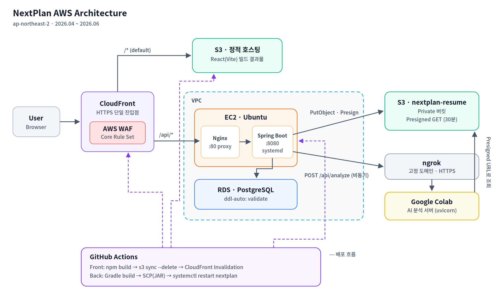
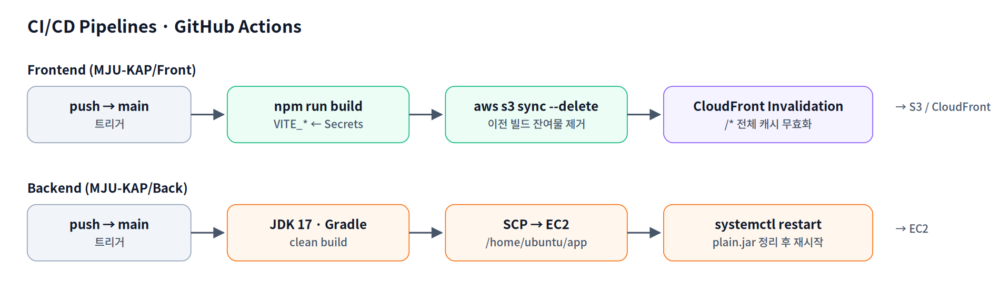

# NextPlan — 취업 준비 플랫폼 AWS 인프라 & CI/CD 구축

> 이력서를 업로드하면 AI가 직무 적합도를 분석해 주는 취업 준비 플랫폼 **NextPlan**의
> **AWS 인프라 설계·구축, GitHub Actions CI/CD, 운영 트러블슈팅**을 담당했습니다.

| 항목 | 내용 |
| --- | --- |
| 기간 | 2026.04 ~ 2026.06 (약 2개월) |
| 형태 | 팀 프로젝트 · [MJU-KAP](https://github.com/MJU-KAP) |
| 담당 | **Cloud / DevOps** — 인프라 구성, 배포 파이프라인, 장애 대응 |
| 원본 레포 | [Front](https://github.com/MJU-KAP/Front) · [Back](https://github.com/MJU-KAP/Back) |
| 기여 | Back 126 커밋 중 50건 (CI/CD·배포·설정·장애 대응 중심), Front 파이프라인 초기 구축 |


---

## 📌 한눈에 보기

- **정적/동적 트래픽 분리**: CloudFront 하나로 `/*`는 S3(React SPA), `/api/*`는 EC2(Spring Boot)로 경로 기반 라우팅
- **CI/CD 2개 파이프라인 구축**: Front는 S3 sync + CloudFront 무효화, Back은 Gradle 빌드 → SCP → systemd 재시작
- **배포 방식 개선**: `nohup` + `fuser -k` 수동 프로세스 관리 → **systemd 서비스화**(자동 재시작, journalctl 로그)
- **시크릿 관리**: DB·JWT·OAuth 값을 코드에서 분리 → GitHub Secrets / systemd 환경변수 / `${ENV}` 플레이스홀더
- **파일 업로드 장애 4단계 추적·해결**: CloudFront 라우팅 → AWS WAF 차단 → 경로 중복 → 요청 헤더/용량 설정
- **외부 AI 서버 연동**: Private S3 + Presigned URL로 파일 전달, 비동기 처리로 긴 분석 시간이 요청을 붙잡지 않도록 구성

---

## 🏗 아키텍처



> 리소스 상세: [docs/aws-resources.md](docs/aws-resources.md)

### 구성 요소별 역할

| 구성 요소 | 역할 | 설계 포인트 |
| --- | --- | --- |
| **CloudFront** | 단일 진입점 (HTTPS) | Behavior로 `/api/*` → EC2 Origin, 나머지 → S3 Origin 분기. 프론트/백엔드가 같은 도메인을 써서 CORS·쿠키 문제를 줄임 |
| **AWS WAF** | L7 보안 필터 | AWS Managed Core Rule Set 적용. 파일 업로드와 충돌하는 `SizeRestrictions_BODY`만 Count로 예외 처리 |
| **S3 (정적)** | React(Vite) 빌드 결과물 호스팅 | 배포 시 `sync --delete`로 이전 빌드 잔여물 제거 |
| **EC2 + Nginx** | API 서버 | Nginx가 80 → 8080 리버스 프록시, Spring Boot는 systemd로 상시 구동 |
| **RDS PostgreSQL** | 사용자·이력서·분석 결과·목표·캘린더 데이터 | `ddl-auto: validate`로 운영 DB 스키마를 앱이 임의로 바꾸지 못하게 고정 |
| **S3 (이력서)** | 업로드 파일 저장 | 버킷은 비공개, AI 서버에는 **30분 만료 Presigned URL**만 전달 |
| **Colab + ngrok** | AI 분석 서버 | GPU 비용 없이 모델 서빙. ngrok **고정 도메인**으로 Colab 재시작 시에도 백엔드 설정 변경 불필요 |


---

## 🚀 CI/CD 파이프라인



> 워크플로 원본: [infra/github-actions/](infra/github-actions/) (변경 이력 버전은 `history/`)

### Frontend — S3 + CloudFront

```yaml
- name: Build
  run: npm run build
  env:
    VITE_API_BASE_URL: ${{ secrets.VITE_API_BASE_URL }}
    # ... 빌드 타임 환경변수는 모두 GitHub Secrets에서 주입

- name: Deploy to S3
  run: aws s3 sync ./dist s3://${{ secrets.AWS_S3_BUCKET }} --delete

- name: CloudFront Invalidation
  run: aws cloudfront create-invalidation --distribution-id ${{ secrets.CLOUDFRONT_DISTRIBUTION_ID }} --paths "/*"
```

- Vite 환경변수는 **빌드 시점에 번들에 박히기 때문에**, Secrets 값을 바꾼 뒤에는 반드시 재빌드·재배포가 필요 → 실제로 값 변경 후 미반영 이슈를 겪고 재배포 커밋으로 해결
- 캐시된 구버전 파일이 남지 않도록 배포 직후 전체 무효화

### Backend — EC2 (SCP + systemd)

```yaml
- name: Build with Gradle
  run: ./gradlew clean build -x test

- name: Copy JAR to EC2
  uses: appleboy/scp-action@master
  with:
    host: ${{ secrets.EC2_HOST }}
    key:  ${{ secrets.EC2_SSH_KEY }}
    source: "build/libs/*.jar"
    target: "/home/ubuntu/app"
    strip_components: 2

- name: Run Application on EC2
  uses: appleboy/ssh-action@master
  with:
    script: |
      rm -f /home/ubuntu/app/*-plain.jar
      sudo systemctl restart nextplan
```

### 배포 방식 개선 과정

| 단계 | 방식 | 문제 |
| --- | --- | --- |
| v1 | `fuser -k 8080/tcp` → `nohup java -jar *.jar &` | 프로세스가 죽으면 그대로 다운, 로그가 파일 하나에 섞임 |
| v2 | v1 + 실행 인자로 `--DB_PASSWORD=${{ secrets.* }}` 전달 | 시크릿이 추가될 때마다 워크플로 수정 필요, 특수문자 포함 값이 쉘에서 깨짐 → 따옴표 처리로 임시 해결 |
| v3 | `*-plain.jar` 제거 단계 추가 | Gradle이 실행 불가능한 `plain.jar`도 생성해서 `*.jar` 와일드카드가 2개를 잡던 문제 |
| **v4 (최종)** | **systemd 서비스 (`nextplan.service`)** | `Restart=always`로 자동 복구, 부팅 시 자동 실행, `journalctl -u nextplan`으로 로그 일원화, 워크플로는 `restart` 한 줄로 단순화 |

```ini
# /etc/systemd/system/nextplan.service (값은 마스킹, 전체: infra/systemd/nextplan.service)
[Service]
User=ubuntu
ExecStart=/usr/bin/java -jar /home/ubuntu/app/NextPlan-0.0.1-SNAPSHOT.jar \
  --DB_URL=jdbc:postgresql://<rds-endpoint>:5432/nextplan \
  --DB_PASSWORD=<masked> \
  --JWT_SECRET=<masked> \
  --KAKAO_REDIRECT_URI=https://<cloudfront-domain>/auth/kakao/callback
SuccessExitStatus=143
Restart=always
RestartSec=10
```

> 회고: 시크릿을 실행 인자로 넘기면 `ps`, `systemctl status` 출력에 평문으로 보인다. 개선 로드맵의 Parameter Store 전환 항목으로 연결.

---

## 🔐 설정 & 시크릿 관리

애플리케이션 설정은 **모든 환경 의존 값을 플레이스홀더로 분리**해 같은 JAR를 로컬/운영에서 그대로 쓰도록 구성했습니다.

```yaml
spring:
  datasource:
    url: ${DB_URL}
    password: ${DB_PASSWORD}
  jpa:
    hibernate:
      ddl-auto: ${JPA_DDL_AUTO:validate}   # 운영은 validate 고정
  servlet:
    multipart:
      max-file-size: 50MB                  # 기본값 1MB → 이력서 업로드용으로 상향
      max-request-size: 50MB

jwt:
  secret: ${JWT_SECRET}

aws:
  s3:
    bucket-name: ${AWS_BUCKET_NAME:nextplan-resume}
    region: ${AWS_REGION:ap-northeast-2}
```

| 위치 | 저장하는 값 |
| --- | --- |
| GitHub Secrets | EC2 접속 정보·SSH 키, S3 버킷, CloudFront 배포 ID, 프론트 빌드 변수 |
| EC2 systemd 환경변수 | DB 접속 정보, JWT Secret, OAuth Redirect URI, AI 서버 URL |
| 코드 (`application.yml`) | 플레이스홀더와 안전한 기본값만 |

---

## 🔥 트러블슈팅

### 1. 파일 업로드 실패 — 4개 레이어를 차례로 뚫은 과정

> 상세 기록과 실제 로그: [docs/troubleshooting/01-file-upload.md](docs/troubleshooting/01-file-upload.md)

이력서 업로드가 운영 환경에서만 실패했습니다. 에러가 바뀔 때마다 **"요청이 어느 레이어까지 도달했는가"** 를 기준으로 범위를 좁혔습니다.

```
Browser → CloudFront(Behavior) → WAF → EC2(Nginx) → Spring Boot → S3 / AI 서버
   ①            ②                  ③                  ④
```

#### ① API 요청인데 `index.html`이 돌아옴 (`server: AmazonS3`)

- **증상**: `/api/*` 요청의 응답 헤더가 `server: AmazonS3`, 본문은 React의 `index.html`
- **원인**: CloudFront에 Default Behavior(S3)만 있어서 API 요청까지 S3로 전달됨. SPA용 에러 페이지 설정 때문에 404 대신 `index.html`이 200으로 내려와 원인이 가려져 있었음
- **해결**: CloudFront에 `/api/*` Behavior 추가 → EC2 Origin, 허용 메서드 `GET, HEAD, OPTIONS, PUT, POST, PATCH, DELETE`, 캐싱 비활성화
- **배운 점**: 응답 헤더의 `server` 값만으로도 요청이 어느 Origin에 도달했는지 바로 판별할 수 있음


#### ② CloudFront `403 Request blocked`

- **증상**: CloudFront가 생성한 403 HTML 응답 (`Generated by cloudfront`)
- **분석**: WAF → Web ACL → **Sampled requests**에서 차단된 요청 확인
  - Terminating rule: `AWS#AWSManagedRulesCommonRuleSet#SizeRestrictions_BODY`
  - `content-length: 646887` (약 631KB) — Core Rule Set은 본문 8KB 초과 요청을 차단
- **선택지 검토**

  | 방법 | 판단 |
  | --- | --- |
  | WAF를 CloudFront에서 분리 | ❌ CloudFront **flat-rate 무료 플랜은 WAF 연결 해제 불가** |
  | Body 검사 한도 상향 | ❌ 무료 한도 초과 시 추가 비용, 근본 해결 아님 |
  | **해당 규칙만 Block → Count** | ✅ 나머지 SQLi·XSS 등 보호 규칙은 유지 |
  | Presigned URL로 S3 직접 업로드 | 근본 해결책이지만 구조 변경 필요 → 개선 과제로 남김 |

- **해결**: `SizeRestrictions_BODY`만 Count로 변경 → 403 해소

#### ③ 403 → 500 `COM-500-001`

- **분석**: `journalctl -u nextplan`으로 서버 로그 확인
  ```
  NoResourceFoundException: No static resource api/api/fileupload
  ```
- **원인 추적**: 컨트롤러(`/api/fileupload`) 정상 → `baseURL` 환경변수 정상 → 프론트 업로드 코드에서
  ```ts
  const endpoint = import.meta.env.PROD ? '/api/api/fileupload' : '/api/fileupload';
  ```
  ①번 라우팅 문제를 겪던 시기에 **운영에서만 경로를 바꿔 끼운 임시방편**이 남아 있었음
- **해결**: 환경 분기 제거, 단일 경로로 통일
- **배운 점**: 인프라 문제를 코드에서 우회하면 인프라를 고친 뒤 새 장애가 된다. 원인은 원인이 있는 레이어에서 고쳐야 함

#### ④ multipart 요청 형식 & 용량

- **원인 1**: Axios 인스턴스 기본 헤더가 `Content-Type: application/json`으로 고정돼 있어 `FormData` 요청의 `boundary`가 생성되지 않음
  → 기본 헤더 제거, 브라우저가 `multipart/form-data; boundary=...`를 자동 설정하도록 변경
- **원인 2**: Spring Boot multipart 기본 한도 1MB
  → `max-file-size` / `max-request-size` 50MB로 상향

**결과**: 업로드 → S3 저장 → AI 분석 요청까지 운영 환경에서 정상 동작

---

### 2. systemd 재시작 무한 루프 (`restart counter is at 29`)

> 상세: [docs/troubleshooting/02-systemd-restart-loop.md](docs/troubleshooting/02-systemd-restart-loop.md)

- **증상**: `systemctl status`는 `active (running)`인데 API는 504. 자세히 보니 재시작 카운터가 계속 증가
- **분석**: `active`는 "방금 다시 켜졌다"는 뜻일 뿐 → `journalctl -u nextplan | grep "ERROR\|Caused by"`
  ```
  PlaceholderResolutionException: Could not resolve placeholder 'app.cors.allowed-origins'
  ```
- **원인**: YAML 리스트로 정의한 CORS 허용 Origin을 `@Value("${...}")`로 단일 값처럼 주입 → 기동 시점 실패 → `Restart=always`가 계속 되살림
- **해결**: 설정 바인딩 방식 수정 후 재배포. 배포된 JAR 타임스탬프(`ls -lt`)로 새 빌드 반영 여부까지 확인
- **배운 점**: `Restart=always`는 장애를 숨길 수 있음 → 상태 확인 시 `active` 여부가 아니라 **재시작 횟수와 기동 로그**를 봐야 함

### 3. 스키마 변경 후 기동 실패 (`ddl-auto: validate`)

> 상세: [docs/troubleshooting/03-schema-validate.md](docs/troubleshooting/03-schema-validate.md)

- **증상**: RDS에 `purpose`, `calendar` 테이블 추가 후 서비스가 `status=1/FAILURE`로 재시작 반복
- **분석**: pgAdmin에서 테이블·스키마(`public`) 존재 확인 → DB 자체는 정상, 엔티티와 테이블 정의 불일치로 Hibernate 검증 실패
- **해결**: 엔티티·DDL 정합성 맞춘 뒤 재배포
- **배운 점**: `validate`는 운영 DB를 보호하는 대신 스키마 변경과 앱 배포의 **순서**를 관리해야 함 → 마이그레이션 도구(Flyway) 도입 필요성 확인

### 4. AI 서버 연동 — 외부 의존성 장애 격리

> 상세: [docs/troubleshooting/04-ai-server.md](docs/troubleshooting/04-ai-server.md)

- **문제**: Colab 세션 만료(무료 약 12시간) 시 ngrok URL이 바뀌어 EC2 환경변수를 매번 수정해야 했음. 분석이 길어지면 요청 전체가 대기
- **해결**
  - ngrok **고정 도메인** 사용 → Colab 재시작과 백엔드 설정을 분리
  - EC2에서 `curl -I` 로 AI 서버 생존 확인 (`405 Allow: POST` = 정상 기동) 하는 점검 절차 정리
  - 업로드 요청은 S3 저장 후 **분석 ID만 즉시 반환**하고, AI 분석은 트랜잭션 커밋 이후 **비동기 처리**(3분 타임아웃) → 상태는 `PROCESSING`으로 기록 후 갱신
  - AI 서버에는 파일 자체가 아닌 **30분 만료 Presigned URL**만 전달 → 버킷을 비공개로 유지

### 5. 그 밖에 해결한 것

| 이슈 | 원인 | 조치 |
| --- | --- | --- |
| Actions 빌드 중 Maven Central 403 | 의존성 다운로드 일시 실패 | 재실행으로 복구, 배포 실패 시 EC2 앱이 내려간 채 남는 문제 → systemd 전환 계기 |
| 운영에서만 카카오 로그인 실패 | Redirect URI가 로컬 값으로 고정 | `KAKAO_REDIRECT_URI`를 환경변수로 분리, 요청 Origin 기반으로 환경별 처리 |
| CORS 오류 | 허용 Origin 설정이 실제 필터에 연결되지 않음 | 설정 클래스로 정리, CloudFront 도메인만 허용 |
| 중복 설정 파일 | `application.properties`와 `.yml` 공존 | `.properties` 제거, 설정 소스 단일화 |

---

## 🧭 한계와 개선 로드맵

프로젝트 기간 안에 "동작하는 구조"를 우선했고, 운영 관점에서 보이는 한계를 다음과 같이 정리했습니다.

| 영역 | 현재 | 개선 방향 |
| --- | --- | --- |
| **가용성** | EC2 단일 인스턴스 (SPOF), 배포 중 다운타임 | ALB + Auto Scaling Group, Blue/Green 또는 Rolling 배포 |
| **배포 보안** | SSH(22) 포트로 Actions 러너가 직접 접속 | **SSM Run Command** 또는 CodeDeploy로 전환, 22번 포트 폐쇄 |
| **AWS 인증** | 프론트 배포에 IAM Access Key를 Secrets에 저장 | **GitHub OIDC + IAM Role**로 장기 자격 증명 제거 |
| **파이프라인** | PR 이벤트에도 배포 실행, 테스트 생략(`-x test`) | PR은 빌드·테스트만(CI), main 머지 시에만 배포(CD) |
| **파일 업로드** | 파일이 CloudFront → WAF → EC2를 통과 | **Presigned PUT URL로 S3 직접 업로드** → WAF 규칙 예외 불필요, EC2 부하 감소 |
| **시크릿** | systemd 유닛에 평문 환경변수 | **SSM Parameter Store / Secrets Manager** + IAM Role로 조회 |
| **프론트 키 노출** | 일부 외부 API 키가 빌드 번들에 포함 | 백엔드 프록시를 거쳐 호출하도록 변경 |
| **AI 서버** | Colab + ngrok (세션 만료, 단일 노드) | 컨테이너화 후 EC2 GPU / ECS / SageMaker Endpoint |
| **모니터링** | `journalctl` 수동 확인 | CloudWatch Agent로 로그·메트릭 수집, 알람 → Slack |
| **IaC** | 콘솔 수동 구성 | Terraform으로 VPC·EC2·RDS·CloudFront 코드화 |
| **DB 변경** | 수동 DDL + `validate` | Flyway 마이그레이션을 배포 파이프라인에 포함 |

---

## 📂 레포 구성

> 원본 AWS 리소스는 프로젝트 종료 후 모두 삭제했습니다. 이 레포는 원본 레포의 설정 파일, 커밋 이력, 작업 당시 로그를 바탕으로 인프라 작업을 기록한 것입니다.

```
nextplan-infra/
├── README.md
├── infra/
│   ├── github-actions/
│   │   ├── frontend-deploy.yml        # S3 + CloudFront 배포 (원본)
│   │   ├── backend-deploy.yml         # EC2 배포 최종본 v4 (원본)
│   │   └── history/                   # v1(nohup), v2(시크릿 인자) — 개선 전 버전
│   ├── systemd/nextplan.service       # Spring Boot 서비스 유닛 (마스킹)
│   ├── nginx/nextplan.conf            # 리버스 프록시 설정 (재구성본)
│   └── spring/application.infra.yml   # 운영 관련 설정 발췌
└── docs/
    ├── aws-resources.md               # 리소스 구성과 근거
    ├── runbook.md                     # 장애 대응 · 점검 명령 모음
    ├── troubleshooting/               # 장애 4건 상세 기록 + 실제 로그
    └── images/                        # 아키텍처 · CI/CD 다이어그램
```

---

## 🛠 Tech Stack

| 분류 | 기술 |
| --- | --- |
| Cloud | AWS EC2, S3, CloudFront, WAF, RDS (PostgreSQL), IAM |
| CI/CD | GitHub Actions, appleboy/scp-action, appleboy/ssh-action, AWS CLI |
| Server | Ubuntu, Nginx, systemd |
| App (참고) | Spring Boot 3.4 / Java 17, React 19 + Vite, Python(uvicorn) AI 서버 |
| Tunneling | ngrok (고정 도메인) |

---

## 📝 관련 글

<!-- TODO: Velog 트러블슈팅 글 링크 -->
- [CloudFront + WAF 파일 업로드 403 해결기](#)
- [nohup에서 systemd로: Spring Boot 배포 개선](#)
